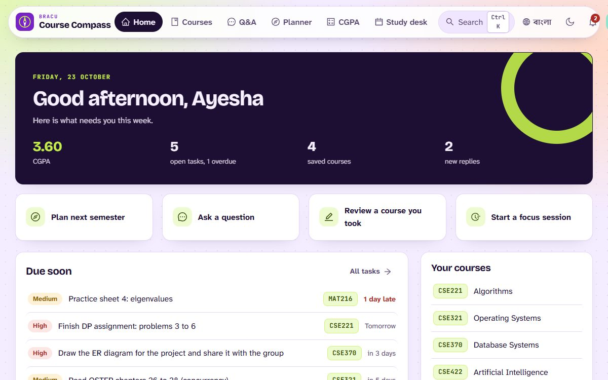
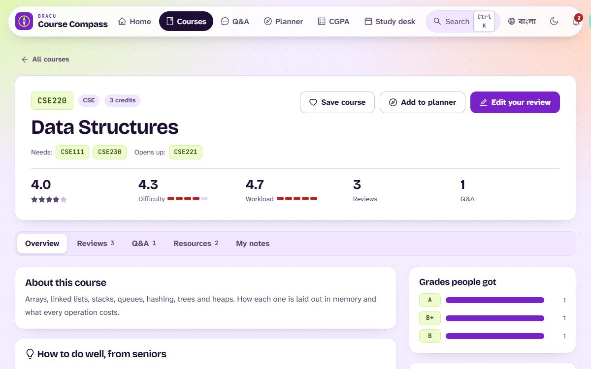
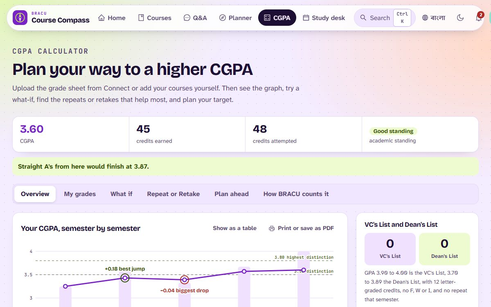

# BRACU Course Compass

[](https://github.com/FaiazPronoy/BRACU-Course-Compass/actions/workflows/tests.yml)

**A course review and study platform for BRAC University students.**
Honest reviews from seniors, a Q&A board for every course, a semester planner,
a CGPA calculator and a study desk, all in one place.

| | |
|---|---|
| **Course** | CSE470: Software Engineering, BRAC University |
| **Type** | Group project |
| **Made by** | Faiaz Abrar Zaman Pronoy and Sinthia Khandoker |
| **Live demo** | https://bracu-course-compass.onrender.com (free hosting, so the first visit can take up to a minute to wake it) |
| **History** | Built in Fall 2024 for the course, improved since, and published here in October 2026. |
| **Languages** | English and Bangla, with a dark mode |

| | |
|---|---|
|  |  |



---

## Features

**Find a course**
- Search by code or name, or press `Ctrl K` anywhere
- Filter by department, sort by rating or "easiest first"
- Each course shows its rating, difficulty, workload, grade spread and prerequisites

**Reviews**
- Rate a course, name the faculty, share your grade and leave tips
- One review per course per student, editable later
- Mark reviews as helpful and comment on them

**Q&A**
- Ask a question about a course
- Upvote answers, and the asker accepts the best one
- Get a notification when someone answers you

**Semester planner**
- Plan courses into future semesters
- Warns you when a prerequisite is missing
- Courses you already passed leave the plan on their own

**CGPA calculator** (works without an account)
- Upload the grade sheet PDF from Connect, or add courses by hand
- Counts the way BRACU counts (repeats, retakes, P, I and W, rounding)
- CGPA graph, VC's List and Dean's List count
- What if, Repeat or Retake planner, and target CGPA

**Study desk**
- Tasks with priority and deadline
- Calendar for classes, quizzes, exams and labs
- Notes with a rich text editor that save as you type and print to PDF
- Watch a course's YouTube playlist next to your notes
- Focus timer (25 / 5 / 15 minutes)

**Dashboard and profile**
- Home page shows what is due, saved courses, recent notes and your CGPA
- Profile with department, student ID and bio

**Admin**
- Overview of accounts, reviews and questions, and remove anything harmful
- Add and edit courses, prerequisites and study links
- Make another user an admin

---

## Built with

| Part | Tools |
|---|---|
| Frontend | React 18, TypeScript, Vite, React Router 7, Redux Toolkit |
| Design | Ant Design 5, custom CSS, Quill, dayjs |
| Backend | Node.js, Express, TypeScript, Mongoose, zod |
| Database | MongoDB |
| Login | JWT, bcrypt, lockout after wrong passwords |
| Tests | Vitest with an in-memory MongoDB, Playwright |

Fonts: Bricolage Grotesque, Atkinson Hyperlegible Next, JetBrains Mono and Anek Bangla.

---

## Demo logins

Run `npm run seed` first. The sign in page also has a one-tap button for each.

| Role | Email | Password |
|---|---|---|
| Student | `ayesha@g.bracu.ac.bd` | `Student@123` |
| Admin | `admin@bracu.ac.bd` | `Admin@1234` |

The demo data has 67 real BRACU courses, 11 students, 36 reviews and 9 Q&A threads.

---

## Run it

You need **Node 20+** and **MongoDB** (local, or a free Atlas cluster).

- **Windows:** double-click `RUN-CourseCompass.bat`. It checks MongoDB, installs the packages, writes `server/.env`, loads the demo data and opens the server and the client.
- **By hand**, the server:

```bash
cd server
npm install
cp .env.example .env
npm run seed
npm run start:dev
```

- Then the client, in a second terminal:

```bash
cd client
npm install
npm run dev
```

Open <http://localhost:5173>.

---

## Settings

Copy `server/.env.example` to `server/.env`. The `.env` file is never committed.

| Variable | What it is |
|---|---|
| `DATABASE_URL` | MongoDB connection string |
| `JWT_ACCESS_SECRET` | A long random string that signs the sign-in token |
| `JWT_ACCESS_EXPIRES_IN` | How long a sign-in lasts (default `7d`) |
| `PORT` | Port for the API (default `3000`) |
| `CLIENT_URL` | Where the client runs in development |
| `SUPER_ADMIN_EMAIL`, `SUPER_ADMIN_PASSWORD` | The admin account created on first start |

---

## Tests

- `cd server && npm test` runs **168 tests** against the real server and an in-memory database
- They cover login, who can edit what, reviews, Q&A, the planner and the CGPA rules
- `tools/browser_checks.py` opens every page as a visitor, a student and the admin, in both themes and both languages

---

## Put it online

The server also serves the built client, so it is one web service.
Use **Render** for the app and **MongoDB Atlas** for the database.

- Build: `cd client && npm ci && npm run build && cd ../server && npm ci && npm run build`
- Start: `cd server && npm start`
- Settings: `NODE_ENV=production`, `DATABASE_URL`, `JWT_ACCESS_SECRET`, `SUPER_ADMIN_EMAIL`, `SUPER_ADMIN_PASSWORD`

---

## Where things are

```
server/src/
  app/modules/   courses, reviews, Q&A, study desk, planner, users, admin
  seed.ts        demo data
server/tests/    the test suites
client/src/
  pages/         one file per screen
  components/    layout, search, forms, note editor
  i18n/          English and Bangla text
tools/           browser checks
```

---

## Not official

This is an independent student project, not a BRAC University service.

## Thanks

The idea of reading the Connect grade sheet in the browser came from
[Should I Retake?](https://github.com/badhon495/should-i-retake) by badhon495.
The reader and the maths here are our own.

---

## Team

Faiaz led the project: he designed the system, built its core and shared the
remaining modules with Sinthia, reviewing each one before it was merged.

- **Faiaz Abrar Zaman Pronoy** (ফাইয়াজ আবরার জামান প্রনয়), lead developer
  - The server: API design, sign in, roles, validation and error handling
  - The CGPA calculator, including the grade sheet PDF reader and BRACU's rules
  - The semester planner and its prerequisite checks
  - The Q&A board, the admin panel and the test suite
- **Sinthia Khandoker** (সিনথিয়া খন্দকার)
  - Course reviews, helpful votes and comments
  - The study desk: tasks, calendar, notes and the focus timer
  - The Bangla translation

## Licence

Copyright 2026 Faiaz Abrar Zaman Pronoy and Sinthia Khandoker. All rights reserved.
You may read the code and run it to try it out. You may not copy it, hand it in
as your own work, or publish it. See [LICENSE](LICENSE).
